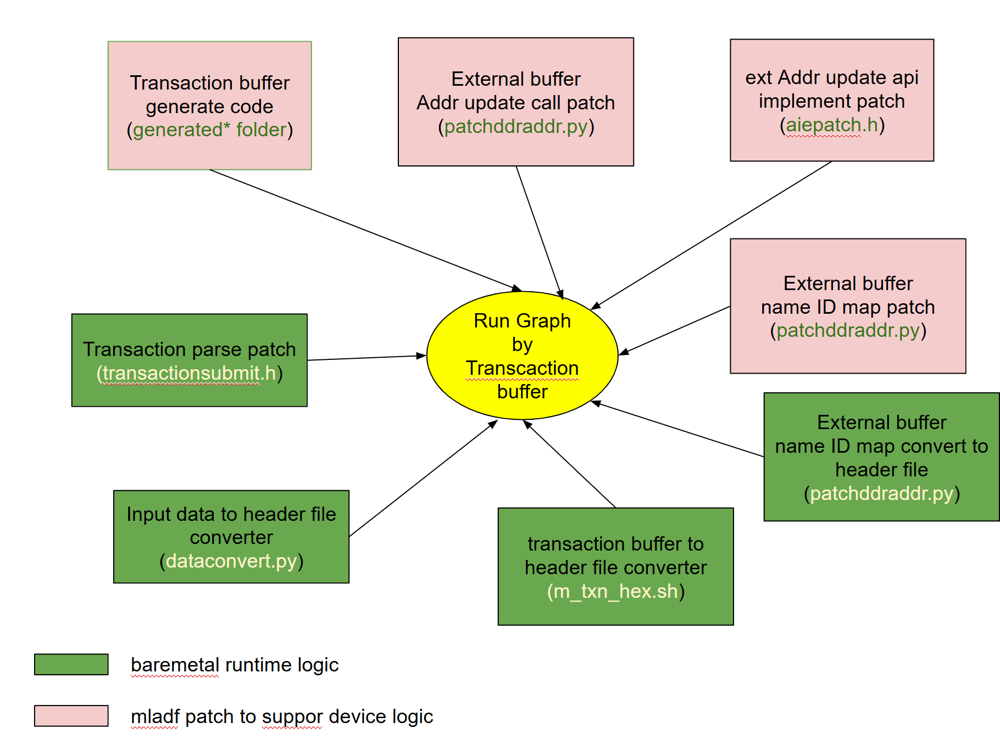

<!--- Copyright (C) 2025 - 2026 Advanced Micro Devices, Inc. --->
<!--- SPDX-License-Identifier: Apache-2.0 --->

# Baremetal ResNet-18 inference on Versal AI Edge (VEK280)

## 1. Architecture



This example runs a ResNet-18 image-classification network on a VEK280 board
(Versal AI Edge) without an operating system, classifying a **224×224 RGB
image** into one of **1000 ImageNet classes**. The AI Engine (AIE-ML) array
executes the convolutional layers and softmax across **28 compute tiles + 1
SoftMax tile** (a 4×7 mesh plus softmax), while a baremetal **Cortex-A72
(APU)** host application drives data flow, accepts inference requests over
TCP/IP (lwIP), and replays the recorded execution plan.

The central idea is shown in the diagram above: at runtime, the entire AIE
control sequence is replayed from a pre-generated **transaction buffer**
rather than issued by an on-host runtime — the "control as data" approach
of the AEG baremetal framework
([arXiv:2604.09565](https://arxiv.org/abs/2604.09565)). In the paper's
terminology, this transaction buffer is a Runtime Control Block (RCB) and
the on-board runtime is its RCB Executor; the README uses "record" / "replay"
for the same build-time / run-time split. The diagram's pink boxes are the
**mladf-side patches** that emit this buffer at build time; the green boxes
are the **on-board baremetal runtime** that parses and dispatches it at
inference time. Section 3 walks through each component.

## 2. Current status

This README describes the single-instance ResNet-18 pipeline as it builds and
runs today: one 4×7 + 1 AIE-ML overlay, one A72 host process serving
inference requests over lwIP, and one ImageNet class returned per request.
Higher-throughput variants — multi-instance overlays and per-instance
batching — are in active development.

The same host application also runs under **Zephyr** (A72 @ EL3), reusing these
sources in place. See [`zephyr/README.md`](./zephyr/README.md) for the Zephyr
build (single-instance and `-inst10`); §5.5 compares the two runtimes.

## 3. how the resnet18 work

The demo lives under `res18sw/` and splits into three top-level folders by
toolchain:

- **`aie/`** — the ResNet-18 ADF graph and AIE-ML kernels (mllib-based).
  Built with the Vitis `aiecompiler`. Its outputs feed every other stage.
- **`sw/`** — the baremetal Cortex-A72 host application, the `mladfpatch/`
  flow that emits the transaction buffer, and the orchestration scripts
  (`build.sh`, `compile.sh`) that produce `Vek280BOOT.BIN`.
- **`demo/`** — host-side tools that don't run on the board: image
  preprocessing (`convertimgtotxt.py`), the TCP client (`client.c`), and
  the gateway proxy (`proxy.c`) used in §4.
- **`zephyr/`** — Zephyr build glue (reuses `sw/` in place); see
  [`zephyr/README.md`](./zephyr/README.md).

The rest of this section walks through each stage in order.

### 3.1 Using the mladf/mllib ResNet-18 graph

The AIE side of this demo (`aie/`) is a standard mllib/ADF design built with
the Vitis `aiecompiler`. The graph **`ResNet18v1 compute_graph`**
(`aie/resnet18_top.cpp`, `aie/multi_layer_resnet18.h`) maps ResNet-18 onto
an AIE-ML overlay whose topology is set in `aie/overlay_config.h`:

```c
#define NUM_ROWS  (4)   // rows of AIE-ML compute tiles
#define NUM_COLS  (7)   // columns  →  4×7 = 28 compute tiles
```

Each conv layer is instantiated as a `single_layer_overlay` (defined in
`aie/single_layer_overlay.h`); ResNet-18's convolutional stack becomes
**23 layer-overlay instances** in the AIE graph (some logical layers are
split across multiple overlay instances), followed by a `softmax_subgraph`
on one additional tile. Per-layer tiling and access patterns live in
`aie/tiling_resnet18.h`; per-tile buffer windows and shim DMA channels are
set alongside `NUM_ROWS` / `NUM_COLS` in `aie/overlay_config.h`.

Building `aie/` (via `aie/Makefile`'s `make compile`, or transitively
through `sw/build.sh`) runs `aiecompiler` against `aie-ml`, producing a
standard Vitis `Work/` directory. The artifact that matters for the rest
of this README is **`Work/ps/c_rts/aie_runtime_control.cpp`** — the
generated runtime-control C++, which the mladfpatch flow rewrites in §3.2
to emit the transaction buffer.

Reference IFM / weights / golden OFM data (hex text form) live under
`aie/data/`, used for `aiecompiler` simulation (`make sim`,
`make check_op`) and as the source for the embedded baremetal weights
(§3.4).
### 3.2 mladfpatch: emitting the transaction buffer at build time

The mladf/ADF runtime in §3.1 normally executes on Linux + XRT, where shim
DMA buffer addresses are resolved live via `adf::getExternalBufferAddress()`.
A baremetal application has no such allocator. **`sw/mladfpatch/` patches the
generated runtime-control code so that wherever it would have set a live
buffer address, it instead emits a custom transaction op that says "look up
DDR address for buffer ID X at runtime."** This preserves mladf's layer
orchestration, addressing math, and tile programming, while retargeting I/O
for an OS-free environment.

**How the patch works.** `sw/mladfpatch/patchddraddr.py` regex-scans the
`aie_runtime_control.cpp` produced in §3.1, finds each
`adf::configureBufferDescriptor(shim_tile, ...)` call, and inserts a
matching `AddDDRCustomOp(...)` call after it. The helper `AddDDRCustomOp`
is defined in `sw/mladfpatch/baremetal/ml_txn/aiepatch.h` and calls
`XAie_AddCustomTxnOp` with a `PatchShimOp` payload describing the buffer
ID, shim column, and BD register to patch at replay time. The same script
also writes **`extern_mapping.h`** — a name→ID table used at inference
time to populate the runtime buffer map.

**How `ml_txn.bin` is generated.** A host-side program **`genTxnMain.out`**
(built by `sw/mladfpatch/baremetal/ml_txn/Makefile`) `#include`s the
patched `aie_runtime_control.cpp` and wraps it in an AI Engine driver
transaction:

```c
// sw/mladfpatch/baremetal/ml_txn/generated-source/gen_txn.cpp
uint8_t* GenerateSerializedTransaction() {
    XAie_StartTransaction(&DevInst, XAIE_TRANSACTION_DISABLE_AUTO_FLUSH);
    executeRuntimeControlInternal();    // patched mladf control flow
    uint8_t *Ptr = XAie_ExportSerializedTransaction(&DevInst, 1, 0);
    XAie_ClearTransaction(&DevInst);
    return Ptr;
}
```

The AI Engine driver normally executes transactions live against hardware;
here the driver runs without a real device and *records* every register
write, masked poll, block write, and inserted DDR-patch custom op into a
byte stream. `XAie_ExportSerializedTransaction` returns that stream, which
`WriteSerializedTransactionToBin` writes to **`ml_txn.bin`** (~450 KB for
this graph). A final `m_txn_hex.sh` step converts it via `xxd -i` into
**`mltxn.h`**, declaring `__ml_txn_bin[]` for link-time embedding into
`vek280.elf`.

One transaction binary describes end-to-end control for the whole graph —
not one per layer.
### 3.3 Transaction buffer parser: replaying control on the board

`ml_txn.bin` is a serialized AI Engine driver transaction: a header
followed by a stream of typed op records. Each record begins with a small
header whose `Op` byte identifies the operation type:

```c
// xaiengine/xaiegbl.h  (Xilinx AI Engine driver header)
typedef struct {
    uint8_t  Major, Minor, DevGen;
    uint8_t  NumRows, NumCols, NumMemTileRows;
    uint32_t NumOps;     // record count
    uint32_t TxnSize;    // total bytes including header
} XAie_TxnHeader;
```

The opcode set covers single-register writes (`XAIE_IO_WRITE`), contiguous
block writes (`XAIE_IO_BLOCKWRITE`), masked writes (`XAIE_IO_MASKWRITE`),
masked polling for readiness (`XAIE_IO_MASKPOLL`), shim-DMA buffer-
descriptor configuration, and custom ops (`XAIE_IO_CUSTOM_OP_*`).

The on-board parser is **`XAie_SubmitSerializedTransaction()`** in
**`sw/transactionsubmit.h`** (entered from `executeRuntimeControl_TXN()`,
which casts `__ml_txn_bin` to `uint8_t*` and submits it). It walks the
record stream, decodes each `Op`, and translates the operation into MMIO
through thin helpers (`AIE_Write32` / `Xil_Out32`) or polling loops. This
is the AEG paper's "control as data" / RCB execution model made concrete:
the binary holds a flattened control sequence, the runtime is a generic
record-walking dispatcher, and the AIE driver primitives are the hardware
abstraction layer.

The custom opcode worth highlighting is **`XAIE_IO_CUSTOM_OP_DDR_PATCH`**,
emitted by mladfpatch in §3.2. When the parser sees one, it resolves the
buffer-name ID via the `external_map[]` table populated at inference time
(§3.4) and patches the shim DMA buffer-descriptor address registers
in-place:

```c
// sw/transactionsubmit.h
else if (OpHdr->Op == XAIE_IO_CUSTOM_OP_DDR_PATCH) {
    PatchShimOp *op = (PatchShimOp *)(Ptr + sizeof(XAie_CustomOpHdr));
    u64 tensorAddr = external_map[op->extBufId] + op->argplus;
    // patch shim BD address registers using tensorAddr
}
```

This indirection is what lets `ml_txn.bin` be generated once at build time
without baking in physical tensor addresses — the host application sets
those addresses per inference (§3.4) and the patch op resolves them during
replay.
### 3.4 Baremetal runtime host logic

The host application that drives inference is `sw/resnet18_top.cpp`,
running baremetal on the Cortex-A72 (APU). At startup it constructs the
graph wrapper, allocates DDR buffers, loads weights once, and enters an
interactive menu loop:

```c
// sw/resnet18_top.cpp  (paraphrased)
BaremetalGraph gr("compute_graph");

int main() {
    ifm_buf = (uint32_t*)gr.malloc(ifm_size + 1024);   // ~200 KB IFM
    wts_buf = (uint32_t*)gr.malloc(wts_size);          // ~12 MB weights
    ofm_buf = (uint32_t*)gr.malloc(ofm_size);          // 2 KB OFM
    gr.init();
    gr.run(-1);                                        // arm the AIE graph

    for (int i = 0; i < wts_size/4; i++) wts_buf[i] = wts32[i];   // hex_data.h
    for (int i = 0; i < NUM_LAYERS; i++)
        ExternSetAddr(gr, "compute_graph.resnet_layers[i].wts_ddr",
                          wts_buf + wts_ddr_offset[i]);

    // Menu: 'l' = local one-shot, 'n' = network server, 'q' = quit
    ...
}
```

`ExternSetAddr` is a one-line helper that consults `nameIdMapping` (from
`extern_mapping.h`, generated in §3.2) to translate a human-readable
buffer name into the numeric ID expected by `XAIE_IO_CUSTOM_OP_DDR_PATCH`,
then writes the DDR address into `external_map[]` — the table the parser
in §3.3 reads at replay time.

Weights are loaded once from `wts32[]`, an embedded C array compiled from
`aie/data/wts32.txt` via `dataconvert.py` → `hex_data.h`. Per inference
the host fills in just IFM and OFM addresses, then runs the transaction:

```c
int16_t process_data(const uint32_t* ifm_data, int ifm_data_len) {
    ExternSetAddr(gr, "compute_graph.ifm_ddr", ifm_data);
    ExternSetAddr(gr, "compute_graph.ofm_ddr", ofm_buf);
    Xil_DCacheInvalidateRange((intptr_t)ofm_buf, (intptr_t)ofm_size);
    executeRuntimeControl_TXN();        // submit __ml_txn_bin
    int idx = argmax((uint16_t*)ofm_buf, 1000);
    return idx;
}
```

**On the run lifecycle.** `gr.run(-1)` at startup "arms" the AIE graph —
kernels are placed in infinite-iteration mode, waiting for data to arrive.
Each call to `executeRuntimeControl_TXN()` then submits one inference's
worth of recorded control to drive the data flow; the host loops without
re-arming the graph between calls. (In the finite-run build path, with
`_INFINITE_RUN_` undefined, `gr.run(1)` is called inside `process_data`
once per inference.) For the network path, `net_process_main(process_data)`
hands the function pointer to the lwIP TCP server, which invokes it on
each received image — see §4 for the host-to-board protocol.
### 3.5 Compile flow

The full chain — from ADF graph source to bootable image — runs in six stages:

1. **`aiecompiler`** consumes `aie/` sources (§3.1), emitting:
   - `aie/Work/ps/cdo/aie_cdo_*.bin` — boot-time AIE partition config
   - `aie/Work/ps/c_rts/aie_runtime_control.cpp` — raw runtime control C++

2. **`patchddraddr.py`** + `aiepatch.h` (§3.2) rewrite the runtime control
   C++ in place, inserting custom DDR-patch ops, and emit `extern_mapping.h`.

3. **`genTxnMain.out`** (built by `sw/mladfpatch/baremetal/ml_txn/Makefile`)
   `#include`s the patched control code, runs it under
   `XAie_StartTransaction`, exports the serialized stream → **`ml_txn.bin`**.

4. **`m_txn_hex.sh`** runs `xxd -i ml_txn.bin > mltxn.h` (declares
   `__ml_txn_bin[]` for link-time embedding).

5. **`aarch64-none-elf-gcc`** (driven by Vitis `script/compile.sh`) compiles
   `sw/resnet18_top.cpp` + the AEG baremetal runtime + lwIP, links against
   the platform libraries → **`vek280.elf`** (Cortex-A72 baremetal).

6. **`bootgen -arch versal`** packages the platform PDI, the AIE CDOs from
   step 1, and `vek280.elf` from step 5 → **`sw/build/Vek280BOOT.BIN`**
   (the artifact flashed to the board).

The orchestration script that drives all six stages is **`sw/build.sh`**.
See §4 for end-user build commands.

## 4. Compile and run the demo

```
cd sw
source ./build.sh -bootgen
```

4.1  Run the baremetal app on HW

4.1.1 Copy files

copy the build app into a network folder

```
cp ./build/Vek280BOOT.BIN /home/huaj/vek280/res18server.bin
```

copy the proxy.c into a network folder, the proxy help to build connect from host to VEK280 AIE Board ethernet

```
cp ./demo/proxy.c /home/huaj/proxy.c
```

4.1.2 Run the app on target board

a. connect vec280 es1 board in XSDB(for example vek280-4)
```
/proj/systest/bin/systest vek280-4
power 0 power 1
xsdb
conn
tar 1
```

b. connect vec280 es1 board host (for example vek280-4). Open this terminal **before** step `d. device program` — otherwise the startup messages and the menu prompt are lost:
```
ssh huaj@muscaria18
/opt/systest/common/bin/systest-client
connect com0
```
c. second ssh to connect vec280 es1 board host (for example vek280-4)

```
ssh huaj@muscaria18
```

build the proxy 

```
gcc -o ./proxy /home/huaj/proxy.c
```

run the proxy

```
./proxy
```

d. run the resnet app in the XSDB server

go the the console created by 'a' step and run the app

```
tar 1
device program /home/huaj/vek280/res18server.bin
```

The UART terminal then prints a menu:

```
Specify any of the below option:
        l - run local classification
        b - benchmark: 100 silent local rounds, then print throughput
        n - run network server and do remote classification
        q - to quit
```

Press `n` for the network demo, `l` for one-shot local classification
using the embedded test image, or `b` for the 100-round benchmark
used to populate the table in §5.5. Multiple inferences per boot are
supported — press `l` and `b` in any order, repeatedly, and the menu
returns between rounds.

The benchmark length is a build-time knob: `-DBENCH_LOOPS=N` changes the
round count, and `-DBENCH_SECONDS=N` bounds the run by wall clock instead
(`EXTRA_DEFINES=` for the baremetal drivers, `-bench_loops` /
`-bench_seconds` for `build_zephyr.sh`). The menu text follows whichever is
set. §5.6 uses the wall-clock form; nothing else about the image changes.

> **Build-script gotcha:** the multi-instance overlay requires
> `./buildbatch110.sh -bootgen`, which sets `-DBATCH_GRAPH -DNUM_INST=10`
> for the SW compile and points `sw/Work` at the multi-instance AIE
> output. Running `./build.sh -bootgen` after a prior `buildbatch110`
> silently produces a SW image whose `ExternSetAddr` calls use
> single-instance buffer names (`compute_graph.ifm_ddr`) while the AIE
> is wired for multi-instance names (`compute_graph.resnet18_0.ifm_ddr`
> … `_9.ifm_ddr`); the result is that `executeRuntimeControl_TXN()`
> hangs in `XAie_MaskPoll` waiting for instances 1–9 that have no
> valid IFM/OFM addresses. Symptom on UART: `process_data ---1` and
> `process_data ---2` print, then it never comes back. Fix: re-run
> `./buildbatch110.sh -bootgen` (or, for N=1: `rm -f Work && ./build.sh -bootgen`).

e. go the console create in step 'b' to make sure the network set up done

after the ip print out the network set done, it will show following message

```
link speed for phy address 1: 1000
Board IP: 10.10.70.1
Netmask : 255.255.255.0
Gateway : 10.10.70.101
TCP echo server started @ port 7
state->file_size = 200704

```

4.1.3 go to demo folder use client app to request classify

a. go the demo folder where there are all tool
```
ssh huaj@xsjsswsip51
cd /scratch/staff/huaj/aiebr/aiebaremetal2/example/example_ai_model/aeg/res18sw/demo
```

b. convert a image into the raw binary

```
python3 ./convertimgtotxt.py /home/huaj/tigercat.jpg
ls ./ifm32.txt.raw
```

c. send the image to AIE baremetal for classification (second arg is the proxy host's reachable IP)

```
./client ./ifm32.txt.raw <proxy-host-ip>
```

d. result

client should see following

```
huaj@xsjsswsip51:/scratch/staff/huaj/aiebr/aiebaremetal2/example/example_ai_model/aeg/res18sw/demo$ ./client ./ifm32.txt.raw <proxy-host-ip>
Received CRC: 2de21a2f
type is 282
```

aie server should see following

```
Executing op 4309 out of 4316 total ops, 99.8378% complete
Executing op 4310 out of 4316 total ops, 99.861% complete
Executing op 4311 out of 4316 total ops, 99.8842% complete
Executing op 4312 out of 4316 total ops, 99.9073% complete
Executing op 4313 out of 4316 total ops, 99.9305% complete
Executing op 4314 out of 4316 total ops, 99.9537% complete
Executing op 4315 out of 4316 total ops, 99.9768% complete
2 type is 282 max from 1000 item
```

e. repeat a to d, to send image for classification

the server support multiple time classify

## 5. Multi-instance overlay (NUM_INST=10) — higher throughput

The `aie/batch1_inst10/` overlay duplicates the §3.1 ResNet-18 graph
**10 times** across the AIE-ML array — 10 independent `compute_graph.resnet18_i`
subgraphs (i = 0..9) classifying 10 input images in one inference round.
At `NUM_ROWS=4 × NUM_COLS=7 + 1 SoftMax` per instance, the full overlay
occupies **(4×7 + 1) × 10 = 290 AIE-ML cores**.

This is the realization of the "higher-throughput variants" §2 mentions.

5.1 Prerequisites (one-time setup, only required on a fresh clone)

`script/settings.sh` attempts to clone three internal third-party repos
over HTTPS, but the failure path is silenced (`|| true`), so SSH-only
users get empty `thirdparty/{xtf, embeddedsw, aielib/aie-rt}` and
confusing missing-header errors mid-build. Clone the three manually
via SSH **before** running `buildbatch110.sh` for the first time:

```bash
cd thirdparty
git clone --recursive git@gitenterprise.xilinx.com:regressions/xtf.git xtf
git clone --recursive git@gitenterprise.xilinx.com:embeddedsw/embeddedsw.git embeddedsw
cd aielib && git clone --recursive git@gitenterprise.xilinx.com:ai-engine/aie-rt.git aie-rt
cd ../..
```

(Also required for the single-instance flow in §4, but historically
undocumented there. A follow-up PR is planned to fix `script/settings.sh`
so this manual step is no longer needed; for now please clone manually.)

5.2 Build

```bash
cd sw
source ./buildbatch110.sh -bootgen
# → sw/build/Vek280BOOT.BIN (~27 MB)
```

The script mirrors `build.sh` but targets `aie/batch1_inst10/` and passes
`-DNUM_INST=10 -DBATCH_GRAPH` to the AIE compile and the baremetal app.
`BATCH_GRAPH` switches `sw/resnet18_top.cpp` to the per-instance data path
(`compute_graph.resnet18_i.ifm_ddr` / `.ofm_ddr` per instance).

5.3 Expected output

After flashing and pressing `l` at the on-board menu (local mode), UART
should print exactly 10 classification lines plus one timing line:

```text
Output 1 took ~40000 us.
inst 0: type is idx 282 type name is  tiger cat
inst 1: type is idx 282 type name is  tiger cat
...
inst 9: type is idx 282 type name is  tiger cat
```

All 10 instances classify the same embedded `aie/data/ifm32.txt` image,
so the result is the same idx repeated. Network mode (`n`) accepts a
single image per request and returns inst 0's classification — protocol
is unchanged from §4.

Per-instance class-name lookup is provided by `sw/synset.h`, an
auto-generated 1000-entry table mirroring `demo/synset.txt`.

5.4 Per-layer interleave patch

A naive `NUM_INST=10` build deadlocks at the first MaskPoll on shim
column 15 — the aiecompiler-generated runtime-control wrapper fires all
broadcast weight source kicks before any per-instance receiver BD is
configured, and the multicast network back-pressures the source until
all 10 receivers are armed. `sw/mladfpatch/patchddraddr.py` post-processes
the generated wrapper into a per-layer 6-phase interleave:

```text
for layer L in 0..22:
    shared KICK[L]    configure 4 source BDs + enqueueTask
    inst_i RECV[L] *10  wts.in[0..3] receivers configured + enqueued
    inst_i REST[L] *10  ifm + compute + waitDMAChannelDone
    shared WAIT[L]    waitDMAChannelDone x4 on source
```

Two invariants enforced: (a) source kick before any receiver poll;
(b) all receivers armed before any wait. The pass autodetects `n_inst`
and supports `NUM_INST` = 2..10. Toggle `PER_LAYER_INTERLEAVE = False`
at the top of `patchddraddr.py` for A/B debugging.

See [`DEBUGGING.MD`](./DEBUGGING.MD) for the full diagnostic methodology,
MaskPoll bail-out instrumentation pattern, and op-index → source-line
correlation workflow used to root-cause this hang.

5.5 Measured performance

Local-mode benchmark (`b`) on VEK280 with the embedded
`aie/data/ifm32.txt` tigercat image, clean builds with no diagnostic
instrumentation, host compiled `-Os` (Zephyr uses
`CONFIG_SIZE_OPTIMIZATIONS`) for an apples-to-apples comparison. `b`
silences per-round UART output inside the timed window, so the measured
wall-clock reflects A72 runtime control + AIE work only (no serial-port
stalls). Both runtimes convert cycles→µs with a single pinned rate
(`RESNET_TS_HZ = 100 MHz`) and report raw cycle counts, removing a ~1%
timer-truncation skew between them; the `b` summary also reports per-round
mean/std/min/max. AIE inference time is data-independent on this fixed
pipeline; measured per-round std is <0.2%. Full per-round statistics and
phase breakdown: [`zephyr/PERF_RESULTS.md`](./zephyr/PERF_RESULTS.md).

| Configuration                                 | Round wall-clock | Per-image cost  | Throughput      | INT8 compute |
|-----------------------------------------------|------------------|-----------------|-----------------|--------------|
| Single-instance, baremetal (`build.sh`)       | 2,719.7 us       | 2,719.9 us      | 367.7 img/s     | 1338.27 GOPS (1.34 TOPS) |
| Single-instance, Zephyr (`build_zephyr.sh`)   | 2,854.0 us       | 2,854.0 us      | 350.4 img/s     | 1275.39 GOPS (1.28 TOPS) |
| N=10, baremetal (`buildbatch110.sh`)          | 19,445.8 us      | **1,944.6 us**  | **514.2 img/s** | **1871.85 GOPS (1.87 TOPS)** |
| N=10, Zephyr (`build_zephyr.sh -inst10`)      | 19,468.3 us      | **1,946.8 us**  | **513.7 img/s** | **1869.71 GOPS (1.87 TOPS)** |

INT8 compute column uses the standard ResNet-18 op count of
**3.64 GOPS / image** (1.82 GMAC × 2 ops per MAC, Conv + FC only;
torchvision / MLPerf convention).

**N=10 vs single-instance (~1.40×, throughput is host-bound, not AIE-bound):**
the 290 AIE-ML cores compute in true parallel across the 10 instances, but
the runtime-control program that orchestrates each layer's DMA setup,
broadcast kick, and completion polls runs single-threaded on the A72, and
weights are streamed DDR → shim → mem-tile per layer (they don't fit
resident). Fitting the per-round wall-clock to `round(N) = A + N·h` (A =
parallel AIE compute, constant; h = serial per-instance host work) gives
**A ≈ 860 us** and **h ≈ 1860 us**. So a round is *dominated by serial host
orchestration*, not AIE compute: at N=10 it is ~860 us AIE + ~18,600 us host
(~96%). Per-image time is `A/N + h`, which asymptotes to h ≈ 1860 us
(~538 img/s); N=10 already reaches 514 img/s (96% of that ceiling), so extra
instances buy almost nothing. Pushing materially higher needs the
runtime-control sequence off the A72 (dedicated controller / RPU offload) — a
separate effort, out of scope for this overlay. The per-layer interleave
invariants the patcher enforces (§5.4) are a correctness fix; they neither
add nor remove meaningful work.

**Zephyr vs baremetal:** with the unified timer, baremetal is marginally but
*genuinely* faster at both points — 4.9% at single-instance (2,719.9 vs
2,854.0 us/image) and 0.12% at N=10 (1,944.6 vs 1,946.8 us/image, ~5× the
standard error of the mean, so still above noise). Both gaps trace to one
fixed per-round cost: the local-`b` Zephyr path copies the embedded image into
its input buffer each round (`ifm_buf[0][i] = ifm_data[i]`, ~150 KB ≈ 150 us)
while baremetal feeds the rodata directly. Being roughly fixed, that copy is
**4.9%** of the short 2.72 ms single round but only **0.12%** of the 10×-longer
19.45 ms N=10 round — which is exactly why baremetal's lead collapses as N
grows. It is a benchmark-only artifact: in real network use both runtimes copy
the received image per round, so the Zephyr port carries no meaningful penalty
in the high-throughput configuration.

5.6 Measured power and energy

Rail power for the same four configurations, read from the system
controller's INA226 monitors over `systest` (no physical board access
needed), together with per-image energy:
[`power/POWER_RESULTS.md`](./power/POWER_RESULTS.md). Headline: N=10 buys
1.40× throughput for 1.8× power, so energy per image is *worse* than
single-instance (29.5 vs 23.3 mJ baremetal) — the same serial control path
that caps throughput in §5.5 also caps energy efficiency, because the array
idles while its static power scales with instance count. Measured on a cold
board the two runtimes draw the same power at both instance counts, so their
energy difference is only the timing gap of §5.5.

Sampling one rail costs 5–7 s, so the measurements need minutes of steady
load rather than the default 100-round `b`. `power/build_measurement_images.sh`
builds the four images with `-DBENCH_SECONDS=300` and
`tutorial/powermeasure/measure_power.py` drives the board and records the
rails. The build side is documented in `POWER_RESULTS.md` ("Building the
images"); the measurement procedure, which applies to any aiebaremetal app,
is in [`tutorial/powermeasure`](../../../../tutorial/powermeasure/README.md).
